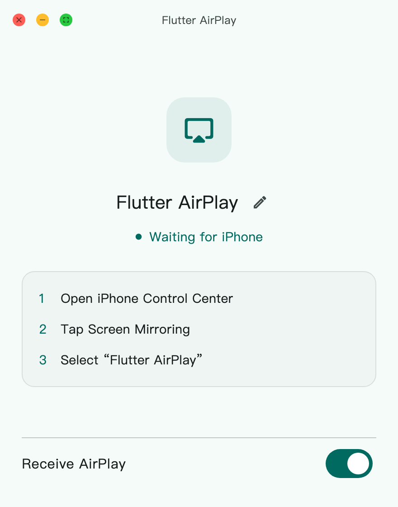
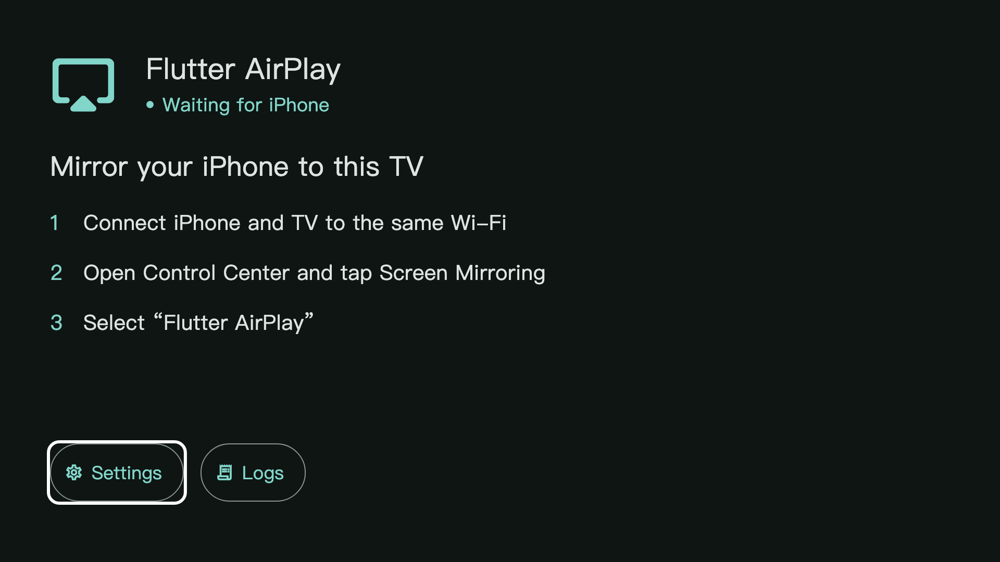

  

<h1 align="center">Flutter AirPlay</h1>

  An open-source AirPlay receiver for mirroring your iPhone, iPad or Mac, with audio. 
  Built with Flutter, C++ and <a href="vendor/UxPlay/UPSTREAM.md">UxPlay</a>.

  
  
  
  

  
  
  
  

  <a href="https://github.com/boyan01/flutter-airplay/releases/latest"><strong>Download</strong></a> ·
  <a href="README_ZH.md">简体中文</a> ·
  <a href="DEVELOPMENT.md">Development</a>

<table align="center">
  <tr><th>Demo</th><th>Desktop</th><th>Android TV</th></tr>
  <tr>
  <td width="220">

https://github.com/user-attachments/assets/1c935c08-dd36-4b4c-be52-38eb88ff2adc

  </td>
  <td></td>
  <td></td>
  </tr>
</table>

## Get started

1. Download and install the package for your platform.
2. Connect the sender and receiver to the same local network.
3. Open Flutter AirPlay and allow local network access. Reception starts automatically by default.
4. On your iPhone, iPad or Mac, open **Control Center → Screen Mirroring** and select the receiver name shown in the app.

Tap the picture, move the mouse or use the TV remote to show playback controls.
Use **More → Disconnect** to end mirroring.

## Features

- **Video and audio:** H.264 / HEVC playback, with native hardware decoding on Apple and Android devices.
- **Picture controls:** choose resolution up to 4K, crop the picture and adjust playback buffering.
- **Desktop:** fullscreen, always on top, video-sized windows, system tray and open at login.
- **Android phone and TV:** background reception, notification controls and TV remote navigation.
- **Updates and diagnostics:** check for updates in Settings → About on macOS, installed Windows builds and Android release builds. View and export logs in the app.

## Platforms

| Platform | Status | Requirements / package |
| --- | --- | --- |
| macOS | Supported | macOS 12+, Apple Silicon. Drag the app from the DMG to Applications. Open at login requires macOS 13+. |
| Android phone / TV | Supported | Android 8.0+, arm64. Install the APK. |
| Windows | Experimental | Windows 10+, x64. Run Setup; Windows N also needs the Media Feature Pack. |
| Linux | Experimental | x64 desktop with GTK 3, FFmpeg 6+, Avahi and PulseAudio/PipeWire. Install the `.deb` or use the bundle. |
| iPad | Experimental | iPadOS 15+. [Build from source](DEVELOPMENT.md#ipad); reception runs while the app is in the foreground. |

Linux requires OpenGL 3.2+ or OpenGL ES 3+. The `.deb` is built on Ubuntu 24.04;
the bundle uses system libraries. macOS packages use ad-hoc signing and are not
notarized; Windows installers are unsigned.

FairPlay / DRM-protected video is unsupported.

## Everyday use

Open **Settings** to change the receiver name, resolution, playback buffer and desktop behavior.
Lower buffering reduces receiver delay but can make playback less stable.
Android uses a foreground service for background reception; grant notification permission
and allow display over other apps if you want playback to open from the background.

On desktop, double-click the picture to toggle fullscreen and press **Esc** to leave it.
Use **⌘ ,** / **Ctrl ,** for settings and **⌘ .** / **Ctrl .** to disconnect.
On TV, use the direction keys and **OK** to operate controls; **Back** closes the menu or hides controls.

## Troubleshooting

- **Receiver missing:** check local network permission and the firewall. Use a network that allows devices to discover each other; guest networks often isolate them. On Linux, check that `avahi-daemon` is running.
- **Black video:** try mirroring the home screen to check whether the source is DRM-protected.
- **Stuttering:** lower the requested resolution or increase the playback buffer in Settings.
- **Other issues:** export logs from the app and include the receiver platform, sender device and reproduction steps in an [issue](https://github.com/boyan01/flutter-airplay/issues).

## Contributing

See [DEVELOPMENT.md](DEVELOPMENT.md) for setup, tests and packaging,
[AGENTS.md](AGENTS.md) for code conventions, and [CHANGELOG.md](CHANGELOG.md) for version history.

## License

[GPLv3](LICENSE). See [UxPlay upstream](vendor/UxPlay/UPSTREAM.md) and
[third-party notices](THIRD_PARTY_NOTICES.md) for dependency sources and licenses.
