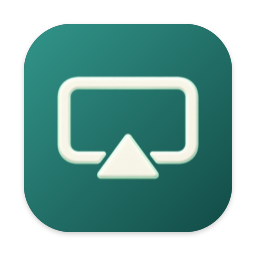
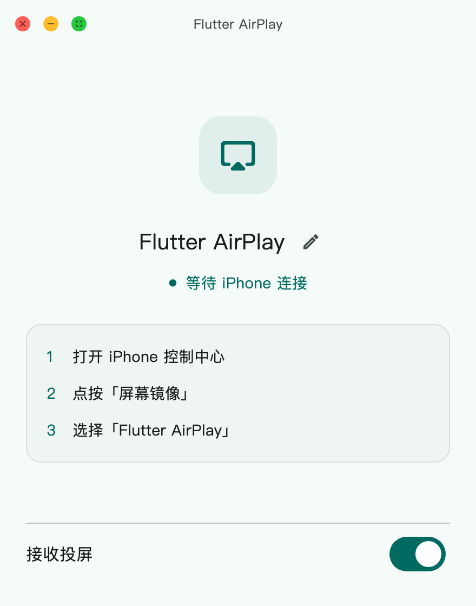
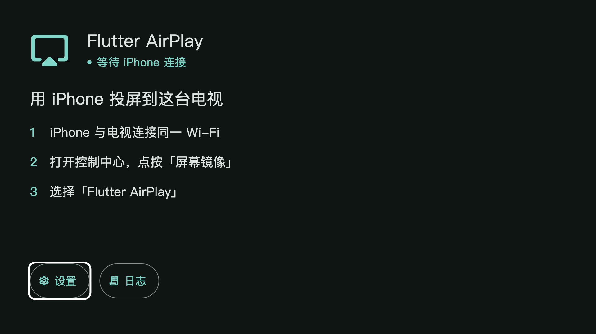

  

<h1 align="center">Flutter AirPlay</h1>

  开源 AirPlay 接收器，接收 iPhone、iPad 和 Mac 的屏幕镜像与音频。 
  使用 Flutter、C++ 和 <a href="vendor/UxPlay/UPSTREAM.md">UxPlay</a> 构建。

  
  
  
  

  
  
  
  

  <a href="https://github.com/boyan01/flutter-airplay/releases/latest"><strong>下载</strong></a> ·
  <a href="README.md">English</a> ·
  <a href="DEVELOPMENT.md">开发指南</a>

<table align="center">
  <tr><th>投屏演示</th><th>桌面端</th><th>Android TV</th></tr>
  <tr>
  <td width="220">

https://github.com/user-attachments/assets/1c935c08-dd36-4b4c-be52-38eb88ff2adc

  </td>
  <td></td>
  <td></td>
  </tr>
</table>

## 开始使用

1. 下载并安装对应平台的应用。
2. 将发送端与接收端连接到同一局域网。
3. 打开 Flutter AirPlay，允许访问本地网络。应用默认自动开始接收。
4. 在 iPhone、iPad 或 Mac 的 **控制中心 → 屏幕镜像** 中，选择应用显示的接收器名称。

点击画面、移动鼠标或操作电视遥控器可显示播放控件。
通过 **更多 → 断开投屏** 结束当前连接。

## 功能

- **画面与声音**：支持 H.264 / HEVC，Apple 和 Android 设备使用原生硬件解码。
- **画面调整**：选择最高 4K 的清晰度、裁剪画面、调整播放缓冲。
- **桌面操作**：全屏、窗口置顶、窗口跟随画面尺寸、托盘常驻和登录启动。
- **Android 手机与电视**：后台接收、通知控制和遥控器导航。
- **更新与诊断**：macOS、Windows 安装版和 Android 正式版可在「设置 → 关于」检查更新。应用内可查看和导出日志。

## 平台

| 平台 | 状态 | 要求 / 安装方式 |
| --- | --- | --- |
| macOS | 支持 | macOS 12+，Apple Silicon。打开 DMG，将应用拖入 Applications。登录启动需 macOS 13+。 |
| Android 手机 / TV | 支持 | Android 8.0+，arm64。安装 APK。 |
| Windows | 实验性 | Windows 10+，x64。运行 Setup；Windows N 还需安装 Media Feature Pack。 |
| Linux | 实验性 | x64 桌面，GTK 3、FFmpeg 6+、Avahi、PulseAudio/PipeWire。安装 `.deb` 或使用 bundle。 |
| iPad | 实验性 | iPadOS 15+。[从源码构建](DEVELOPMENT.md#ipad)，保持应用在前台接收。 |

Linux 需要 OpenGL 3.2+ 或 OpenGL ES 3+。`.deb` 在 Ubuntu 24.04 上构建，
bundle 使用系统库。macOS 包使用 ad-hoc 签名，尚未公证；Windows 安装包尚未签名。

不支持 FairPlay / DRM 保护的视频。

## 日常操作

在「设置」中修改接收器名称、清晰度、播放缓冲和桌面行为。
较低的缓冲可减少接收端延迟，但可能增加卡顿。
Android 通过前台服务保持后台接收，请允许通知权限。
如需在后台收到投屏时打开播放页面，还需授予「显示在其他应用上层」权限。

桌面端双击画面切换全屏，按 **Esc** 退出全屏。
**⌘ ,** / **Ctrl ,** 打开设置，**⌘ .** / **Ctrl .** 断开投屏。
电视端使用方向键和 **OK** 操作，**Back** 关闭菜单或隐藏控件。

## 常见问题

- **找不到接收器**：检查本地网络权限和防火墙，使用允许设备互相发现的网络。访客网络通常会隔离设备。Linux 上确认 `avahi-daemon` 正在运行。
- **画面黑屏**：先投屏手机主界面，确认是否只有受 DRM 保护的视频无法显示。
- **播放卡顿**：在设置中降低清晰度或增加播放缓冲。
- **其他问题**：从应用导出日志，在 [issue](https://github.com/boyan01/flutter-airplay/issues) 中附上接收平台、发送设备和复现步骤。

## 参与开发

环境、测试和打包见 [DEVELOPMENT.md](DEVELOPMENT.md)，
代码约定见 [AGENTS.md](AGENTS.md)，版本记录见 [CHANGELOG.md](CHANGELOG.md)。

## 许可

[GPLv3](LICENSE)。依赖来源与许可见 [UxPlay 上游记录](vendor/UxPlay/UPSTREAM.md)
和 [第三方声明](THIRD_PARTY_NOTICES.md)。
